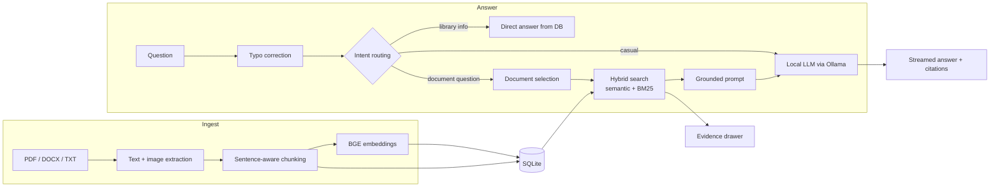

<h1 align="center">CognifyAI</h1>

<p align="center">
  <b>Ask questions. Get answers you can verify.</b><br>
  A fully local document Q&amp;A system built on hybrid retrieval, where every answer is traced back to the exact passage it came from.
</p>

<p align="center">
  
  
  
  
  
  
  
</p>

---

## Why CognifyAI

CognifyAI is a document Q&A system that runs entirely on your own machine and backs up every answer. Cloud chatbots send your files to a third-party API and return fluent answers you cannot check. CognifyAI keeps your data local and links each answer to the exact passage it came from, so you can verify it in one click.

## What it does

- **Answers only from your documents.** The model is constrained to retrieved context and says so plainly when the documents do not contain the answer.
- **Shows its work.** Every reply carries clickable citations that open an Evidence drawer with the source chunk, document name, and relevance score.
- **Runs entirely on your machine.** Embeddings, search, storage, and the language model are all local. After the one-time model download, no data leaves your computer.
- **Finds the right document by itself.** In a library of many files, a question is routed to the document it belongs to, or you can scope it by ticking files.
- **Copes with messy questions.** Typos, shorthand, and loose grammar still land on the right passage.
- **Extracts images too.** Images embedded in PDF and Word files are extracted and shown in a gallery with a lightbox.

## Architecture



## Key engineering decisions

| Decision | Reasoning |
|---|---|
| **Hybrid retrieval (70% semantic / 30% BM25)** | Embeddings blur exact terms such as IDs, names and acronyms. Keyword scoring recovers them. Scores are min-max normalised before blending. |
| **Document routing before retrieval** | Plain top-k search mixed up facts between similar documents. Narrowing to the right file first, using filename matches, profile-document detection and an LLM router, removed those errors. |
| **Per-document coverage guarantee** | Comparison questions must see every scoped file, so each contributes at least one relevant chunk. |
| **Neighbour-chunk expansion** | Adjacent chunks are pulled in so answers that span a chunk boundary are not cut off. |
| **Conservative query rewriting** | Follow-ups are rewritten only when genuinely anaphoric ("what about her CGPA?"), with a guard that stops the model inventing names. |
| **Strict grounding prompt** | The model must cite sources and admit gaps. Hallucinated answers are treated as bugs, not quirks. |
| **Versioned index** | Changing chunking or embedding settings triggers an automatic re-index of existing documents. |
| **Small-model friendly** | Designed for lightweight local models. Runs on `llama3.2:3b` and gives better phrasing with `qwen2.5:7b`. |

## Quality and testing

Retrieval and routing were hardened against real failure cases found during development: wrong-person answers, questions routed to the wrong document, pronoun follow-ups, typos and shorthand, image requests, and questions the documents cannot answer. The last case returns a clear "not specified" instead of an invented answer.

Data hygiene is part of the design. Deleting a document removes its chunks, images, stored file, and any evidence cited for it in earlier chats.

## Tech stack

| Layer | Technology |
|---|---|
| API | FastAPI, Pydantic, httpx |
| Storage | SQLite |
| Retrieval | sentence-transformers (`BAAI/bge-small-en-v1.5`), rank-bm25, NumPy |
| Document parsing | PyMuPDF, python-docx, Pillow |
| LLM | Ollama (local), streamed over NDJSON |
| Frontend | React 19, Vite, react-markdown |

## Project layout

```
backend/app/main.py   ingestion, routing, hybrid retrieval, chat API
frontend/src/         React single-page app
docs/                 demo page
```

## Configuration

| Variable | Default | Purpose |
|---|---|---|
| `OLLAMA_URL` | `http://127.0.0.1:11434` | Address of the local Ollama server |
| `OLLAMA_MODEL` | `llama3.2:3b` | Chat model used for answers |

## Trade-offs

- **Local model, not a cloud API.** This keeps data private and costs nothing to run, but a 3B to 7B model is less fluent than a hosted one. The retrieval and grounding layers are there to make up the difference.
- **Text-based PDFs only.** Scanned documents need OCR, which is on the roadmap.

## Roadmap

- [ ] OCR for scanned PDFs
- [ ] Optional cross-encoder reranking stage
- [ ] Conversation export with citations
- [ ] Automatic per-document summaries on upload

## License

Released under the [MIT License](LICENSE).
